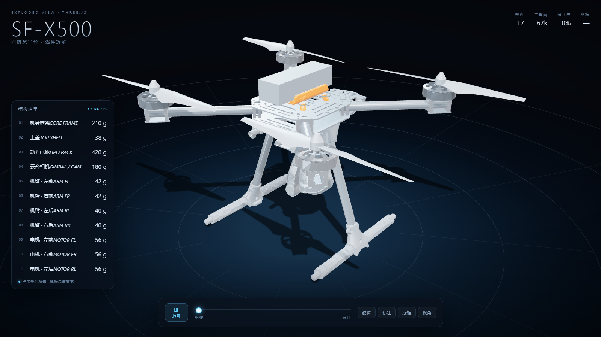
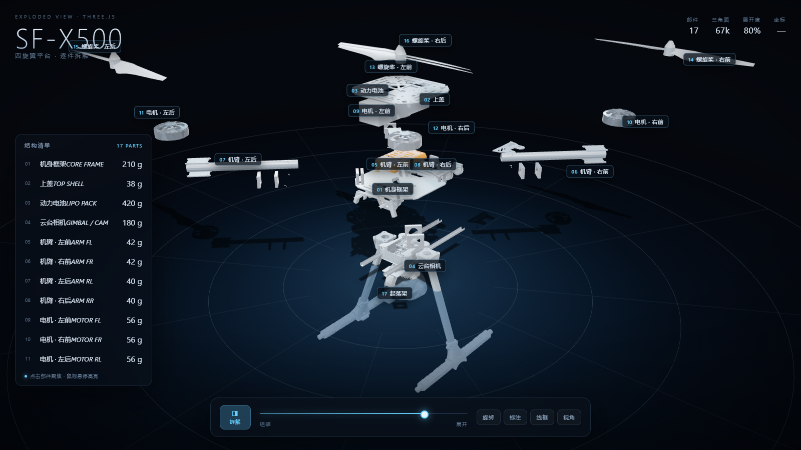

# SF-X500 · 四旋翼爆炸拆解视图

一个纯前端的三维爆炸拆解（Exploded View）演示：四旋翼无人机被拆成 **17 个可交互部件**，可以滑动逐层展开、点选查看每一件的说明与参数。

- **零构建**：双击 `index.html` 就能跑，不需要 Node、不需要本地服务器
- **零外部资源**：three.js 与模型都放在仓库里，断网也能用
- **可交互**：拖拽旋转、滚轮缩放、点部件看卡片、BOM 清单联动、标注/线框/自动旋转开关





## 操作

| 操作 | 效果 |
| --- | --- |
| 拖拽 / 滚轮 | 旋转 / 缩放 |
| 拖动底部滑块 | 逐件展开（0% 组装 → 100% 完全拆开） |
| 点「拆解」或空格 | 一键展开 / 合拢 |
| 点左侧清单或模型上的部件 | 高亮 + 右侧显示说明卡片 + 相机聚焦 |
| 数字键 1–9 | 快速选中前 9 个部件 |
| 旋转 / 标注 / 线框 / 视角 | 自动旋转、部件标注、线框模式、复位机位 |
| Esc | 关闭说明卡片 |

## 目录结构

```
index.html            页面骨架与 HUD
css/style.css         深色玻璃拟态样式
js/config.js          部件元数据（中文名、说明、规格、拆解方向与距离）
js/scene.js           渲染器 / 相机 / 灯光 / 环境反射 / 检验台地面
js/drone.js           GLB 载入、部件切分、爆炸位移、拾取与高亮
js/ui.js              BOM 清单、部件卡片、底部控制条
js/main.js            启动流程、交互绑定、动画主循环
assets/sf-x500.glb    模型本体（供二次开发 / 重新导出用）
assets/model-b64.js   同一模型的 base64 内联副本（file:// 下必须，见下）
vendor/               three.js r147 UMD + OrbitControls / GLTFLoader / CSS2DRenderer / RoomEnvironment
tools/inspect_glb.py  打印 GLB 的节点树与部件 id，便于扩充清单
tools/make_b64.py     由 assets/sf-x500.glb 重新生成 assets/model-b64.js
```

## 为什么要有 `model-b64.js`

浏览器在 `file://` 协议下禁止 `fetch` 本地文件，`GLTFLoader.load()` 会直接失败。所以这里把 GLB 以 base64 内联成脚本，用 `GLTFLoader.parse()` 解析，双击打开就能看到模型。

改完 `assets/sf-x500.glb` 后重新生成：

```bash
python tools/make_b64.py
```

如果你想用常规方式加载（放到服务器上），删掉 `index.html` 里 `assets/model-b64.js` 那行即可，`js/drone.js` 会自动回退到 `GLTFLoader.load(APP.MODEL_URL)`。

## 部件是怎么来的

模型的每个可拆部件都是一个带 `extras.id` 的节点（`body` / `topCover` / `battery` / `gimbal` / `arm_*` / `motor_*` / `propeller_*` / `landingGear`）。`js/drone.js` 遍历场景，凡是有这个 id 的节点就收集成一个部件，再按 `js/config.js` 里同 id 的条目决定中文名、说明、拆解方向与距离。

新增部件只要两步：模型节点上写 `extras.id`，然后往 `APP.PARTS` 里加一条。

拆解方向用世界坐标描述，运行时自动换算到部件的父级坐标系，并按父级缩放折算距离——所以改模型缩放不会破坏拆解效果。部件进度做了错峰（`delay`），展开时按「电池 → 云台 → 机臂 → 电机 → 桨」的顺序先后飞出。

## 已知取舍

- **法线重建**：导出的 GLB 里被精简掉了法线数据，标准材质会渲染成全黑。载入时会拆成非索引几何再 `computeVertexNormals()`，得到逐面法线（机械件更利落，但圆角处会有细碎棱面）。
- **材质提亮**：这套模型的碳纤维基色接近纯黑，在暗背景里读不出结构，载入时把过暗的基色往青灰方向抬了一点（`js/drone.js` 里 `lum < 0.09` 那段）。
- **标注布局**：CSS2D 标签做了奇偶错位，部件多时中间仍可能略挤，可以按需在 `makeLabels()` 里调 `spread`。

## 调试参数

`index.html` 支持这些 URL 参数，方便截图与深链：

```
?explode=0.8      初始展开度
?view=top         初始机位（three / top / side / front）
?labels=0         关闭标注
?spin=0           关闭自动旋转
?clean=1          隐藏加载层（截图用）
?noshadow=1       关闭阴影
?test=1           放一颗白色测试球，排查灯光链路
```

## 许可

- 代码：MIT，见 [LICENSE](LICENSE)
- 模型 `assets/sf-x500.glb`：来自 [PX4/PX4-gazebo-models](https://github.com/PX4/PX4-gazebo-models)（`models/x500_base`、`models/gimbal`），**BSD-3-Clause**，Copyright (c) 2022 Rudis Laboratories / PX4 Autopilot for Drones；经 glTF-Transform + meshoptimizer 减面处理。原始说明保留在 [models/SOURCES.md](models/SOURCES.md) 与 [models/LICENSE.txt](models/LICENSE.txt)。
